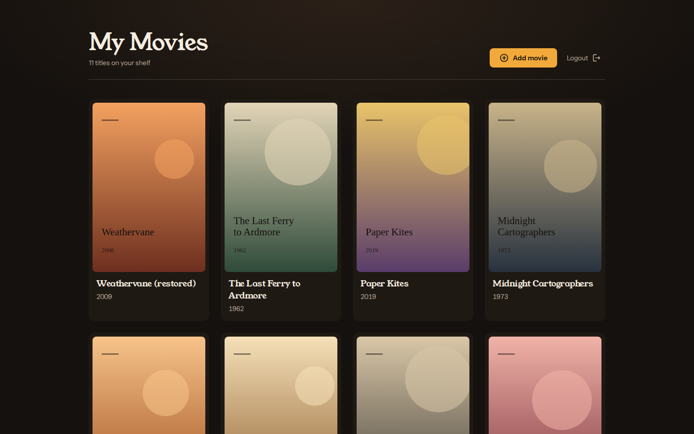
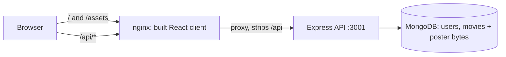

# Movie List

A private shelf for the films you own: sign in, add a title with its year and a poster, page through the collection, fix a typo, swap a poster or delete an entry. This monorepo holds the React client (`movies-list-web`) and the Express + MongoDB API (`movies-list-api`), plus a Postman collection for the API. It does not stream films or fetch metadata from a commercial catalogue; every title and poster is something the user uploads.



Phone views: [list](movies-list-web/docs/screenshots/mobile-list.png) and [edit](movies-list-web/docs/screenshots/mobile-edit.png). Desktop: [sign-in](movies-list-web/docs/screenshots/desktop-signin.png) and [edit](movies-list-web/docs/screenshots/desktop-edit.png). The screenshots come from the Compose stack below, with invented titles and generated gradient posters.

## Run it with Docker Compose

You need Docker with Compose v2. From the repository root:

```sh
cp .env.example .env
# In .env: set JWT_SECRET to 32+ random characters (openssl rand -hex 32)
# and SEED_USER_PASSWORD to 12+ characters for the demo account.
docker compose up -d --build --wait
docker compose run --rm api npm run db:seed
```

Open http://localhost:8080 and sign in as `demo@example.invalid` with the password you chose. The seed command only creates that one account and leaves it alone if it already exists. There is no registration screen.

`docker compose down` stops the stack; add `-v` to delete the MongoDB volume as well.

## How the pieces fit



nginx serves the Vite build and forwards `/api/` to the API container, so the browser only ever talks to one origin. The API is not published on a host port. Its rate limiter trusts exactly one proxy hop, so a client cannot spoof `X-Forwarded-For` by calling it directly.

## What the API returns

These are responses from the Compose stack (`http://localhost:8080/api`), with the token shortened.

```http
POST /api/login
Content-Type: application/json

{"email":"Demo@Example.invalid","password":"<seed password>"}
```

```json
{"token":"eyJhbG...","user":{"id":"6af1c9fb369fda0c102f2b58","email":"demo@example.invalid"}}
```

Lists are owner-scoped, newest first, and leave the poster out:

```http
GET /api/movies?page=1&pageSize=2
Authorization: Bearer <token>
```

```json
{"movies":[{"_id":"6af1ca14b86a423b782d59c0","title":"Weathervane","imageType":"image/png","publishYear":2008,"userId":"6af1c9fb369fda0c102f2b58","__v":0},
           {"_id":"6af1ca14b86a423b782d59bd","title":"The Last Ferry to Ardmore","imageType":"image/png","publishYear":1962,"userId":"6af1c9fb369fda0c102f2b58","__v":0}],
 "page":1,"pageSize":2,"total":11}
```

The poster has its own route and comes back byte-for-byte as uploaded:

```http
GET /api/movies/6af1ca14b86a423b782d59c0/poster

HTTP/1.1 200 OK
Content-Type: image/png
Content-Length: 16971
Cache-Control: private, no-cache
X-Content-Type-Options: nosniff
```

Bad input is refused with a reason the client shows as is:

| Request | Status | Body |
| --- | --- | --- |
| A text file uploaded as `poster.png` | 415 | `{"message":"Posters must be PNG or JPEG images"}` |
| `publicationYear=1700` | 400 | `{"message":"Give a title of 1-200 characters and a four-digit publication year"}` |
| Another user's movie ID | 404 | `{"message":"Movie not found"}` |
| The 11th failed sign-in from one address in 15 minutes | 429 | `{"message":"Too many failed sign-in attempts; try again in 15 minutes"}` |
| Any request with a token after `POST /logout` | 401 | `{"message":"Unauthorized - Invalid token"}` |

The full route list is in the [API README](movies-list-api/README.md). [`postman/Movie-List.postman_collection.json`](postman/Movie-List.postman_collection.json) has every route, with scripts that store the token and a movie ID.

## Design choices worth knowing

- **One active token per account.** A JWT must have a valid signature *and* match the token stored on the user. Signing in elsewhere or logging out revokes the old one at once, at the cost of one session per account.
- **Posters live in MongoDB, served separately.** Each poster is a `Buffer` on its movie document, capped at 5 MiB and checked by its leading bytes rather than by the claimed content type. Earlier versions returned posters inside list JSON as arrays of numbers; a 590 KB poster became about 3.5 MB of JSON. Now lists are a few hundred bytes per movie, and the client fetches each poster as a blob with the bearer token.
- **Every query carries the owner.** Reads, updates and deletes filter on `{ _id, userId }`, so another user's ID looks exactly like a missing one.
- **The client follows the session.** Any 401 clears the stored token and returns to sign-in; the movie routes are guarded; edit links work on refresh because the movie is loaded by ID when there is no navigation state.

## Develop without Docker

Each package pins Node 22 (`.nvmrc`, `engines`). You still need a MongoDB, for example `docker run -d -p 27017:27017 mongo:8.2`.

```sh
cd movies-list-api
npm ci
cp .env.example .env        # set JWT_SECRET and SEED_USER_PASSWORD
npm run build && npm run db:seed
npm run dev                 # http://127.0.0.1:3001

cd ../movies-list-web
npm ci
cp .env.example .env        # VITE_API_URL=http://127.0.0.1:3001
npm run dev                 # http://localhost:3000
```

After `npm install` at the root, `npm start` runs both dev servers together.

## Checks

| Package | Command | What it covers |
| --- | --- | --- |
| API | `npm test` | 34 Jest tests: owner scoping, paging, poster route, delete, input and image validation, login normalisation and rate limit, stored-token auth, CORS, malformed JSON, health |
| API | `npm run lint`, `npm run typecheck`, `npm run build` | ESLint 10 + typescript-eslint, `tsc` |
| Web | `npm test` | 31 Vitest tests: list states and paging, poster URL cleanup, sign-in and remember-email, 401 handling, edit by ID, delete confirmation, form validation and API errors |
| Web | `npm run lint`, `npm run typecheck`, `npm run build` | ESLint 9 with react-hooks and jsx-a11y, `tsc`, Vite build |

The API tests mock the Mongoose models. The real MongoDB path (seed, login, create, list, poster round-trip, update, delete, logout, rate limit) was exercised against the Compose stack, and the Postman collection runs cleanly against it.

## Limits

- The token lives in `localStorage`, readable by any script on the page; an HttpOnly cookie session would need API changes.
- Posters are not re-encoded, so camera metadata (EXIF) in an uploaded JPEG is stored and served back as is.
- Accounts are created only by the seed command; there is no sign-up, password change or reset.
- Storing posters in MongoDB keeps the stack to one database. A large catalogue would want object storage and cacheable image URLs instead.
- The fonts load from Google Fonts; offline, the system serif and sans-serif stacks are used.

## License

MIT, see [LICENSE](LICENSE).
