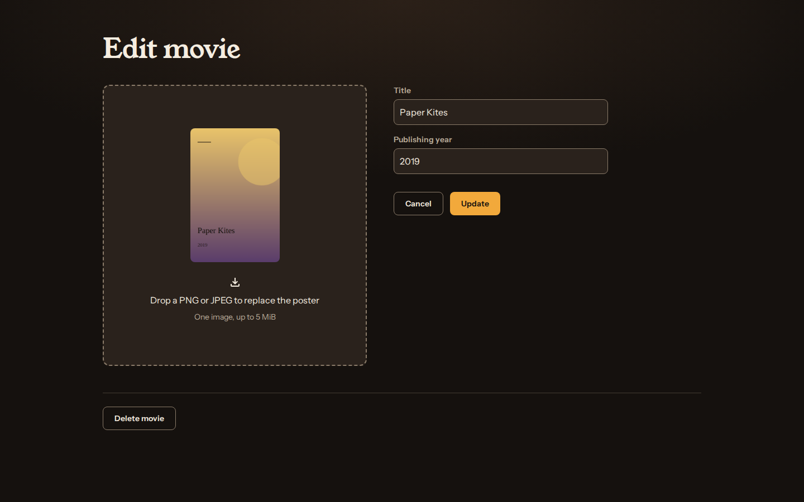
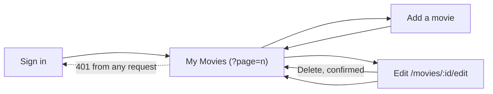

# movies-list-web

The React 18 client for [Movie List](../README.md): sign in, browse your movies eight to a page, add one with a poster, edit or delete it. It is built with Vite and styled with Tailwind, uses Formik + Yup for forms, and talks to [`movies-list-api`](../movies-list-api).



## Run it

With the API running on `http://127.0.0.1:3001` (see its README, or use the root `docker compose` setup):

```sh
npm ci
cp .env.example .env    # VITE_API_URL=http://127.0.0.1:3001
npm run dev             # http://localhost:3000
```

`VITE_API_URL` is baked into the bundle at build time and is public, so it must never hold a secret. The Docker image builds with `VITE_API_URL=/api` and lets nginx proxy that path to the API.

```sh
npm test               # 31 Vitest tests (jsdom)
npm run lint           # ESLint 9 with react-hooks and jsx-a11y
npm run build          # tsc --noEmit, then vite build into dist/
```

## Screens



- **Sign in.** The "Remember email" box keeps only the email in `localStorage`, never the password. The page shows the API's own reason for a failure, such as wrong credentials, the rate limit or an unreachable server.
- **My Movies.** Shows the total count, a two-to-four-column grid of poster cards, and Prev/Next paging stored in the URL. There are separate loading, empty, error and past-the-last-page states.
- **Add / Edit.** The poster drop zone takes one PNG or JPEG up to 5 MiB. Editing shows the current poster until a new one is dropped, and a pasted or refreshed edit link loads the movie by ID. Delete asks for confirmation inline. Validation matches the API: titles of 1-200 characters, years from 1888 to five years ahead.

Posters are fetched with the bearer token from `GET /movies/:id/poster` and shown through object URLs that are revoked when the card unmounts.

## Look and accessibility

The palette suits a dim projection room: warm charcoal surfaces, paper-coloured text and a marquee-amber accent. Headings use Young Serif and body text uses Instrument Sans, both from Google Fonts with system fallbacks. All text pairs measure at least 7.8:1 contrast and field borders 3.8:1.

Every field has a visible label tied to its error message with `aria-describedby`. Every control has an amber focus ring. Loading text is announced as a status and failures as alerts.

## Known limits

- The bearer token is kept in `localStorage`, where page scripts can read it.
- There is no registration or password screen; accounts come from the API's seed command.
- Tests mock the API module. The end-to-end flow was exercised in a browser against the Compose stack, which is also where the screenshots come from.
